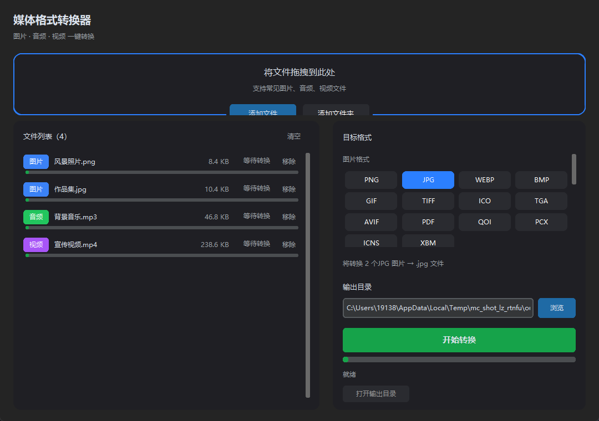

# 媒体格式转换器

一个简洁美观的图片、音频、视频格式转换工具。拖入文件 → 选择格式 → 一键转换。

支持 **45 种**常见格式，内置 FFmpeg，无需额外安装任何依赖。



## 功能特性

- **格式全面**：覆盖图片、音频、视频共 45 种常见格式
- **拖拽即用**：支持拖入文件或整个文件夹，自动识别媒体类型
- **清晰进度**：文件列表内每个文件都有独立进度条，实时显示转换进度
- **批处理**：一次转换多个文件，单文件失败不影响其他文件
- **安全省心**：默认输出到源文件目录，同名自动加序号，绝不覆盖原文件
- **保留细节**：透明通道、照片方向、GIF 动画均会正确处理
- **开箱即用**：内置 FFmpeg，安装包无需 Python 环境

## 支持格式

### 图片（14 种）

| 格式 | 说明 | 格式 | 说明 |
| --- | --- | --- | --- |
| PNG | 无损 / 透明 | JPG | 有损 / 通用 |
| WEBP | 现代图片格式 | BMP | 位图 |
| GIF | 动图 / 静态 | TIFF | 印刷 / 无损 |
| ICO | 图标 | TGA | 纹理 |
| AVIF | 新一代高效格式 | PDF | 文档 |
| QOI | 快速无损 | PCX | 老旧位图 |
| ICNS | macOS 图标 | XBM | 单色位图 |

### 音频（15 种）

`MP3` · `WAV` · `FLAC` · `AAC` · `M4A` · `OGG` · `OPUS` · `WMA` · `AIFF` · `AC3` · `MKA` · `MP2` · `AMR` · `SPX` · `CAF`

### 视频（16 种）

`MP4` · `MKV` · `AVI` · `MOV` · `WEBM` · `WMV` · `ASF` · `FLV` · `MPEG` · `VOB` · `M4V` · `TS` · `M2TS` · `3GP` · `OGV` · `GIF`

## 下载与安装

1. 打开 [Releases](../../releases/latest) 页面
2. 下载 `MediaConverter_Setup_1.0.0.exe`
3. 双击运行，按向导完成安装（安装到当前用户目录，无需管理员权限）

安装完成后可在开始菜单或桌面找到「媒体格式转换器」。

> 系统要求：Windows 10 / 11（64 位）

## 使用方法

1. 将图片、音频或视频文件拖入窗口，或点击「添加文件 / 添加文件夹」
2. 在右侧选择目标格式（可按类型分别选择）
3. 确认输出目录（默认与源文件相同）
4. 点击「开始转换」，等待进度条完成即可

转换完成后可点击「打开输出目录」查看结果。

## 从源码运行

```bash
pip install -r requirements.txt
python app.py
```

> 音频、视频转换依赖 `imageio-ffmpeg` 自带的内置 FFmpeg，无需单独安装。

## 构建安装包

```powershell
# 1. 打包为可执行程序（输出 dist\MediaConverter\MediaConverter.exe）
powershell -ExecutionPolicy Bypass -File build\build_exe.ps1

# 2. 使用 Inno Setup 生成安装包
#    先安装 Inno Setup 6：winget install JRSoftware.InnoSetup
ISCC.exe build\installer.iss
# 输出：dist\installer\MediaConverter_Setup_1.0.0.exe
```

## 技术栈

- [Python](https://www.python.org/) 3.10+
- [CustomTkinter](https://github.com/TomSchimansky/CustomTkinter) — 现代化桌面界面
- [Pillow](https://python-pillow.org/) — 图片转换
- [imageio-ffmpeg](https://github.com/imageio/imageio-ffmpeg) — 内置 FFmpeg，负责音频 / 视频转换
- [tkinterdnd2](https://github.com/pmgagne/tkinterdnd2) — 拖拽支持
- [Inno Setup](https://jrsoftware.org/isinfo.php) — Windows 安装程序

## 项目结构

```
media_converter/
├── app.py              # 图形界面
├── core.py             # 转换引擎（Pillow + FFmpeg）
├── formats.py          # 格式注册表与类型探测
├── requirements.txt    # 运行依赖
├── assets/             # 图标与截图
├── build/              # 打包脚本
│   ├── make_icon.py    # 生成应用图标
│   ├── build_exe.ps1   # PyInstaller 打包
│   └── installer.iss   # Inno Setup 安装程序脚本
└── dist/               # 构建产物（不提交到仓库）
```

## 许可证

本项目基于 [MIT License](LICENSE) 开源。
